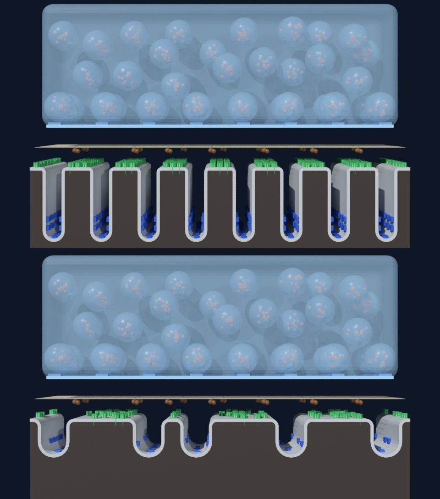

# AChR-MG 分子动画 · 3D 制作手册（Blender + Molecular Nodes + ChimeraX）

> 版本：v0.1
> 配套：[`AChR-MG_分子动画分镜脚本_5min.md`](AChR-MG_分子动画分镜脚本_5min.md)（34 个镜头、5:00）与仓库 [`production/`](../production/) 文件夹
> 软件版本（2026-10 核实）：Blender 5.2 LTS + Molecular Nodes 520.x；ChimeraX 为辅助工具
> 原则：与分镜一致，画面只表现学界共识；结构数据的用途边界和待核实项在第 4、8 节列出。

---

## 0. 流程总览

```
ChimeraX：查看、核对、叠合结构 ─────────┐
                                        ▼
PDB 结构 ──→ Blender + Molecular Nodes：导入结构、搭场景、做动画 ──→ 渲染 PNG 序列（24 fps）
                ▲                                                         │
分镜脚本 ──→ shots.json（镜头标记）                                        ▼
分镜脚本 ──→ 配音稿 ──→ 配音 / TTS ──────────────────────────→ 剪辑软件：画面 + 配音 + 字幕（SRT）→ 成片
分镜脚本 ──→ subtitles_zh.srt ───────────────────────────────────┘
```

全部 3D 工作在**你自己的电脑**上完成：渲染需要显卡和图形界面，下载结构需要能访问 RCSB PDB。

---

## 1. 在你的电脑上安装

| 软件 | 用途 | 获取方式 |
|---|---|---|
| **Blender 5.2** | 搭场景、动画、渲染 | blender.org 下载，免费开源 |
| **Molecular Nodes 520.x** | 在 Blender 中导入并显示蛋白结构 | Blender → 编辑 → 偏好设置 → 获取扩展（Get Extensions）→ 搜索 Molecular Nodes → 安装。版本号 520.x 对应 Blender 5.2；若用 Blender 4.5 LTS，请装对应的 4.5.x 版 |
| **ChimeraX**（可选） | 检查链信息、叠合结构 | UCSF 官网下载；学术、非营利与个人用途免费，商业用途需另行授权 |
| **剪辑软件** | 合成画面、配音、字幕 | DaVinci Resolve（免费版即可）或剪映 |

硬件建议：有独立显卡的电脑（EEVEE 渲染依赖显卡）；内存 16 GB 以上（大型复合物计算分子表面较耗内存）。

---

## 2. `production/` 文件说明与使用顺序

| 文件 | 作用 | 测试情况 |
|---|---|---|
| `blender/mg_project_setup.py` | 新建项目：1920×1080、24 fps、7200 帧、色彩管理 Standard；建立全部配色材质；时间轴放置 S01–S34 镜头标记；搭建接头剖面骨架（正常版 + 受损版）、摄像机与灯光 | 已在 Blender 5.2.3 中运行并渲染预览 |
| `blender/mg_import_structures.py` | 下载并导入真实蛋白结构；按分子描述自动配色；AChR 五聚体自动定向；打印抗体表位报告 | 已用离线结构文件测试分类、配色、定向与表位报告；**联网下载一步未能在测试环境中运行**（网络受限），需在你电脑上首次运行时确认 |
| `chimerax/inspect_achr_structures.cxc` | 并排查看 9DMH、9DMJ、5HBT 并画接触界面图 | 未运行（测试环境无法安装 ChimeraX） |
| `chimerax/build_mir_model_9DMH_5HBT.cxc` | 把 Fab35 叠合到全长人源 AChR 上，供 S11 使用 | 未运行（同上） |
| `post/subtitles_zh.srt` | 字幕，可直接导入剪辑软件 | 由分镜自动生成 |
| `post/narration_zh.txt` | 逐镜配音稿 | 由分镜自动生成 |
| `post/shots.json` | 镜头时间表（含 24 fps 帧号） | 由分镜自动生成 |
| `tools/storyboard_to_post.py` | 分镜改动后重新生成上面三个文件 | 已运行 |

**使用顺序**

1. **新建项目**：打开 Blender → 新建常规文件 → 切到 Scripting 工作区 → 打开 `mg_project_setup.py` → 点"运行脚本" → 另存为 `mg_project.blend`。
   脚本会清空当前场景，所以务必在新文件中运行。
2. **导入结构**：在同一文件中打开 `mg_import_structures.py`，按需修改顶部的 `IMPORT_CODES` → 运行。首次下载需几分钟。
   输出信息（每条链的归类、定向结果、表位报告）在系统控制台中查看：Windows 用"窗口 → 切换系统控制台"；macOS / Linux 需从终端启动 Blender。
3. **逐镜制作**：时间轴上的 S01–S34 标记就是各镜头起点，按第 5 节逐镜方案制作。
4. **渲染**：每个镜头单独设置帧范围，输出 PNG 序列（见第 7 节）。
5. **后期**：在剪辑软件中按时间码排列各镜头，加入配音与 `subtitles_zh.srt`。
6. **分镜改了时间**：运行 `python production/tools/storyboard_to_post.py` 更新字幕、配音稿和 `shots.json`；再在 Blender 中把 `mg_project_setup.py` 顶部的 `MODE` 改为 `"markers"`、`SHOTS_JSON` 填为 `shots.json` 的完整路径并运行——只更新镜头标记，不会清空场景。



*`mg_project_setup.py` 生成的接头剖面骨架（测试环境中用 Cycles 低采样渲染，非最终画面）。上：正常版；下：受损版（褶皱变浅变宽、数目减少，受体与钠通道减少）。*

---

## 3. 比例与坐标约定

**单位**：1 Blender 单位（BU）= 1 nm，与 Molecular Nodes 520.x 的默认比例一致。导入的真实结构与骨架中的代理模型大小可以直接对照。

| 结构 | 骨架中的尺寸 | 与真实情况的关系 |
|---|---|---|
| 初级突触间隙 | 50 nm | 按真实数量级 |
| 脂双层 | 4 nm | 按真实数量级 |
| 突触小泡 | 直径 40 nm | 按真实数量级 |
| AChR 代理 | 直径约 8 nm，长 16 nm，伸出膜面 6 nm | 按真实数量级 |
| 褶皱深度 | 90 nm | **压缩**（真实约 0.5–1 μm） |
| 褶皱间距 | 60 nm | **压缩** |
| ACh 小球 | 半径 2.2 nm | **放大**（真实 < 1 nm） |

**坐标约定**
- z = 0 是嵴顶突触后膜的外表面（朝向间隙）；膜占 z = 0 到 −4；神经末梢膜在 z = 50。
- 导入的 AChR 五聚体挂在名为"`编号_锚点`"的空物体下。锚点就是孔道轴与膜外表面的交点：把锚点移到嵴顶上任意 z = 0 的位置，真实受体就以正确朝向插在膜中，可直接替换代理模型。
- 导入的结构默认沿 x 轴排开，放在 z = −600，避开剖面摄像机。

**两级尺度**
- **接头级**：S03、S05、S07、S08、S14、S16、S17、S21、S22、S24、S27 等，使用骨架与代理模型。
- **结构级**：S04、S06、S11、S13、S15、S18–S20、S30、S31 等，使用真实蛋白结构，背景放一小块平面膜即可。

---

## 4. 结构资产清单（PDB 编号已核实）

| 分子 | 编号 | 内容 | 用于镜头 | 使用边界与注意 |
|---|---|---|---|---|
| 人成人型肌肉 AChR | **9DMG**（apo）<br>**9DMH**（ACh 结合态） | 冷冻电镜，人源 α2βδε；Li 等，*Cell* 2025 | S03–S08 | 9DMH 含结合位点上的 ACh，适合 S06。两者所处功能状态（静息、脱敏等）请对照原文【需要文献验证】 |
| AChR + MG 患者来源 Fab | **9DMJ**（2 个 fab1b）、9DMK（1 个 fab1b）、9DML（fab2）、9DMQ（fab3）、9DMS（fab6）、9DMT（fab7） | 同一研究，6 种患者来源单抗 | S11–S15 参考 | 原文将各抗体与阻断、内化、补体激活等机制对应，但**哪个 Fab 对应哪种机制需查原文**【需要文献验证】。导入脚本的表位报告可辅助判断（见 6.2） |
| α1 胞外域 + Fab35 | **5HBT** | X 射线 2.61 Å；Noridomi 等，*eLife* 2017 | S11 | mAb35 是经典 MIR 抗体，可与约 65% 的患者抗体竞争。结构只含 α1 胞外域，需叠合到 9DMH 上使用（见 6.1）；结构中的 α-银环蛇毒素不显示 |
| 电鳐 AChR | 6UWZ | 冷冻电镜 2.69 Å，电鳐（*Torpedo*）天然受体 + α-银环蛇毒素；Rahman 等，*Neuron* 2020 | 备选 | 非人源；毒素占据 ACh 结合位点，不适合表现正常结合 |
| IgG1 | **1HZH** | 完整人 IgG1（b12），X 射线 2.70 Å；Saphire 等，*Science* 2001 | S10、S15、S18 | 抗 HIV 抗体，只作 IgG1 外形参考 |
| IgG4 | **5DK3** | 全长 IgG4（帕博利珠单抗），X 射线 2.28 Å；Scapin 等，*Nat Struct Mol Biol* 2015 | S31 | 含 S228P 铰链突变（其本身不发生 Fab 臂交换），只作 IgG4 外形参考；Fab 臂交换为示意动画 |
| C1q 球状头部 | **1PK6** | X 射线 1.85 Å；Gaboriaud 等，*J Biol Chem* 2003 | S18 | 胶原样"茎"部无完整实验结构，需示意建模；不要把 Fc 六聚体平台画成定论 |
| C3b | **2I07** | X 射线 4 Å；Janssen 等，*Nature* 2006 | S19 | — |
| 膜攻击复合物 | **6H03**（开放构象） | 冷冻电镜约 5.6 Å；Menny 等，*Nat Commun* 2018 | S20 | 分辨率较低，适合 surface 样式；6H04 为闭合构象 |
| 乙酰胆碱酯酶 | **4EY4** | 人 AChE（apo），X 射线 2.16 Å | S08 | ColQ 胶原尾需示意建模 |
| Nav1.4 | **6AGF** | 人 Nav1.4–β1，冷冻电镜 3.2 Å；Pan 等，*Science* 2018 | S07、S22、S25 | — |
| MuSK | **2IEP** | 大鼠 MuSK 胞外 Ig1–2，X 射线 2.21 Å；Stiegler 等，*J Mol Biol* 2006 | S30–S31 | 只有胞外前两个 Ig 结构域，全长需示意 |
| agrin–LRP4 | **3V64** | X 射线 2.85 Å；Zong 等，*Genes Dev* 2012 | S30 | 不含 MuSK；三者的组装关系为示意 |
| rapsyn | AlphaFold **Q13702** | 预测模型（UniProt Q13702） | S30 | 非实验结构，低置信度区域不宜特写；也可直接用简化形状 |

导入脚本 `mg_import_structures.py` 的 `STRUCTURES` 表已列出以上编号；`IMPORT_CODES` 默认只导入 9DMH、9DMJ、5HBT、1HZH，其余按镜头需要再加入。

**自动配色规则**（按每条链在 mmCIF 中的分子描述）：AChR → 绿（α 亚基略深 `#23864A`，便于标出 MIR 所在亚基）；Fab / IgG → 红；C1q → 浅紫；C3b → 中紫；C5–C9 → 深紫；AChE → 棕；Nav1.4 → 钴蓝；MuSK → 青蓝；LRP4 → 淡黄；agrin → 白；rapsyn → 深灰；ACh 配体 → 橙色球体；糖链和未归类蛋白 → 中性灰。毒素、水、离子、去垢剂和脂质不显示。

---

## 5. 逐镜 3D 制作方案

帧号按 24 fps 计算，与 `shots.json` 和时间轴标记一致。"2D"表示建议在剪辑或合成软件中制作，不必进 3D。

| 镜号 | 帧范围 | 尺度 | 主要资产 | 关键做法 |
|---|---|---|---|---|
| S01 | 1–72 | 2D | 片名 | 剪辑软件制作，或在 Blender 中放两个剪影 |
| S02 | 73–288 | 宏观（另建场景） | 人体线框、神经、肌纤维 | 摄像机沿曲线路径推进（"跟随路径"约束）；结尾硬切到 S03 剖面 |
| S03 | 289–480 | 接头级 | 骨架 | 摄像机沿 x 轴横移；各部件依次淡入（材质 Alpha 或显示关键帧） |
| S04 | 481–672 | 结构级 | 9DMH | 摄像机绕锚点环绕；亚基标签后期叠加 |
| S05 | 673–912 | 接头级 | 骨架 + Ca²⁺ 粒子 | Ca²⁺ 用粒子从间隙一侧涌入；小泡融合用形态键（Shape Key）把球体压向膜并开口；ACh 用粒子发射 |
| S06 | 913–1128 | 接头级 → 结构级 | 骨架、9DMH | ACh 用随机游走（几何节点噪波偏移）落入结合口袋，终点取 9DMH 中 ACh 的位置；**通道开放用代理模型示意**（见第 8 节） |
| S07 | 1129–1392 | 接头级 → 宏观 | 骨架、肌纤维 | 嵴顶膜的发光强度关键帧向谷底扩散；Nav 代理依次点亮；收缩切到宏观肌纤维 |
| S08 | 1393–1608 | 接头级 | 骨架、4EY4 | ACh 球被"剪开"：替换为两个半球并分开 |
| S09 | 1609–1848 | 2D | 阈值示意图 | 合成软件制作，S25 复用 |
| S10 | 1849–2088 | 接头级（加毛细血管） | 1HZH | 抗体沿曲线流动后穿出血管、扩散进入间隙 |
| S11 | 2089–2328 | 结构级 | 9DMH + 5HBT 叠合模型 | 抗体沿路径接近并"扣上"；MIR 高亮可用 Molecular Nodes 选区单独设材质 |
| S12 | 2329–2424 | 2D | 三个图标 | — |
| S13 | 2425–2664 | 结构级 | 9DMH + 阻断型 Fab | 选用哪个 Fab 须先按 6.2 核对【需要文献验证】；ACh 小球撞到抗体后弹开 |
| S14 | 2665–2808 | 接头级 | 骨架 | 复制部分 AChR 代理，改用 `MG_AChR_Inactive` 灰绿材质 |
| S15 | 2809–3048 | 结构级 | 两个 AChR + 1HZH | IgG 两臂分别对准相邻两个受体的 MIR（示意摆放）；其余抗体陆续加入 |
| S16 | 3049–3264 | 接头级（胞质侧视角） | 骨架、溶酶体球 | 膜内陷用形态键；溶酶体融合用缩放与透明度过渡；不画网格蛋白外壳 |
| S17 | 3265–3504 | 接头级 ×2 | 骨架 | 两段分别渲染，在剪辑中分屏 |
| S18 | 3505–3744 | 结构级 | 多个 1HZH + 1PK6 + 示意茎部 | C1q 茎部用曲线建模；多个"花头"同时抓住相邻 Fc |
| S19 | 3745–3960 | 结构级 | 2I07 | 大量 C3b 用几何节点"在点上实例化"沉积到膜上 |
| S20 | 3961–4200 | 结构级 | 6H03 | 各亚基依次出现（显示关键帧）；C9 环形排列可用阵列修改器 |
| S21 | 4201–4344 | 接头级 | 骨架局部 | 预先切出一块膜片（连同其上的受体）单独做漂离动画 |
| S22 | 4345–4560 | 接头级 | 正常版 + 受损版 | 两版骨架位置一致，用叠化或分屏过渡（大纲视图中切换 `NMJ_Scaffold_受损`） |
| S23 | 4561–4728 | 2D | 三栏图标 | — |
| S24 | 4729–4968 | 接头级（受损版） | 骨架 | 沿用 S05–S06 机位；只让少数受体发光 |
| S25 | 4969–5184 | 2D | 复用 S09 | — |
| S26 | 5185–5448 | 宏观 | 肌纤维圆柱 | 部分纤维发光收缩，部分保持灰暗 |
| S27 | 5449–5736 | 接头级（正常版 + 受损版） | 骨架 | 两侧各渲染一遍再分屏；每次冲动释放的 ACh 依次减少 |
| S28 | 5737–5952 | 2D | 示波器波形 | — |
| S29 | 5953–6240 | 接头级 + 2D | 骨架、简笔人物 | 小泡数量回升用显示关键帧；人物时间轴在 2D 中做 |
| S30 | 6241–6456 | 结构级 | 3V64、2IEP、Q13702 | 三者组装关系为示意 |
| S31 | 6457–6768 | 结构级 | 5DK3 + 2IEP | Fab 臂交换为示意：复制半个抗体并改用 `MG_IgG4_OtherArm` 材质；全程不出现紫色 |
| S32 | 6769–6936 | 2D / 合成 | 两型对比卡 | — |
| S33 | 6937–7104 | 宏观 | 复用 S02 | 摄像机反向拉远 |
| S34 | 7105–7200 | 2D | 免责声明字卡 | — |

---

## 6. 关键建模步骤

### 6.1 S11 的 MIR 模型：把 Fab35 叠合到全长人源 AChR 上

5HBT 只含 α1 胞外域。用 ChimeraX 把它的 α1 胞外域叠合到 9DMH 的一个 α 亚基上，Fab35 就落在全长受体的 MIR 位置。步骤见 `production/chimerax/build_mir_model_9DMH_5HBT.cxc`：

1. `open 9dmh`、`open 5hbt`
2. `matchmaker #2 to #1`：按序列自动叠合，Log 中会写明配对的链。
3. 在 Log 的 "Chain information" 表中确认链名后，删除 5HBT 中重复的 α1 胞外域和毒素链（`delete #2/链名`）。
4. `clashes #2 restrict #1`：检查 Fab35 是否与相邻亚基明显碰撞。
5. `combine #1,2 modelId 3 name AChR_Fab35`，再 `save AChR_Fab35_MIR.cif models #3`。
6. 在 Blender 中导入：把 `mg_import_structures.py` 顶部改为 `IMPORT_CODES = ["AChR_Fab35"]`、`LOCAL_FILES = {"AChR_Fab35": "文件的完整路径"}`，再运行。

这是叠合得到的**示意模型**，不是实验测定的复合物结构，片中和资料说明里都应如实标注。若 ChimeraX 保存的文件丢失了分子描述，导入后会显示为中性灰，需要在 Blender 中手动指定材质。

### 6.2 核对患者来源 Fab 的结合位置（S13 选用阻断型抗体之前）

对 9DMJ、9DML、9DMQ、9DMS、9DMT 逐个运行导入脚本。控制台会打印每个 Fab 接触到的受体残基，并标出：
- "落在 MIR 核心"：接触残基包含 α 亚基的 WNP.DYGG 序列模体（成熟肽 α67–76）；
- "接触 C 环"：接触 α 亚基邻位双半胱氨酸附近的残基（ACh 结合口袋的一部分）。

报告只按结构几何给出提示，**哪个抗体属于阻断型、内化型或补体激活型，以 Li 等（*Cell* 2025）原文为准**【需要文献验证】。

### 6.3 受损版突触后膜

`mg_project_setup.py` 会同时生成正常版和受损版。受损版参数在脚本的 `DAMAGED` 字典中：褶皱数 8 → 5、深度 90 → 45 nm、开口加宽，AChR 代理保留约 35%、Nav1.4 代理保留约 40%。**这些比例只为前后对比示意，不代表定量病理数据。**受损版默认从视图层中排除，在大纲视图中勾选 `NMJ_Scaffold_受损` 即可启用。

---

## 7. 渲染与输出

- **引擎**：大部分镜头用 EEVEE（快）；S04、S11、S20 等结构特写可改用 Cycles，以获得更好的环境光遮蔽效果。
- **色彩管理**：脚本已设为 Standard。不要改回默认的 AgX，否则配色会被压暗、去饱和，与 HEX 不符。
- **分镜头渲染**：每个镜头单独设置帧范围（以时间轴标记为准），输出到 `//render/S05/` 这样的独立文件夹。
- **输出格式**：PNG 序列，渲染中断时不会丢失已完成的帧；合成后再导出视频。
- **规格**：1920×1080、24 fps（脚本已设置）；如改为 25 或 30 fps，请用 `storyboard_to_post.py --fps` 重新生成 `shots.json`，并同步修改 `mg_project_setup.py` 中的 `FPS`。

---

## 8. 3D 专项核对清单

在分镜脚本第四部分清单的基础上，3D 制作还需逐项核对：

- [ ] 1 BU = 1 nm；嵴顶膜外表面在 z = 0；受体锚点放在膜面上。
- [ ] AChR 胞外段朝上伸入间隙；抗体结合在胞外段顶部；补体从抗体 Fc 端起始；MAC 插在突触后膜上。
- [ ] **构象变化不"冒充"真实结构**：通道开放、MuSK–LRP4–agrin 组装、C1q 茎部、Fab 臂交换都是示意。手头的静态结构不能表现门控过程，不要用真实结构做出"看似数据支持"的开放动画。
- [ ] 结构用途边界（见第 4 节）：5HBT 只有 α1 胞外域；1HZH 是抗 HIV 的 IgG1；5DK3 含 S228P 突变；rapsyn 为预测模型；6H03 分辨率较低；2IEP 为大鼠蛋白。
- [ ] 毒素、去垢剂、脂质等实验成分不出现在画面中。
- [ ] 9DMG / 9DMH 的功能状态，以及患者来源 Fab 与致病机制的对应关系，制作前对照原文核实【需要文献验证】。

---

## 9. 参考来源

结构数据（编号与基本信息已于 2026-10 对照 RCSB PDB 记录核实）：

- Li H, …, Hibbs RE. Autoimmune mechanisms elucidated through muscle acetylcholine receptor structures. *Cell*. 2025. doi:10.1016/j.cell.2025.03.004（9DMG、9DMH、9DMJ、9DMK、9DML、9DMQ、9DMS、9DMT）
- Noridomi K, et al. Structural insights into the molecular mechanisms of myasthenia gravis and their therapeutic implications. *eLife*. 2017;6:e23043. doi:10.7554/eLife.23043（5HBT）
- Rahman MM, et al. Structure of the native muscle-type nicotinic receptor and inhibition by snake venom toxins. *Neuron*. 2020;106:952–962.e5. doi:10.1016/j.neuron.2020.03.012（6UWZ）
- Saphire EO, et al. Crystal structure of a neutralizing human IgG against HIV-1: a template for vaccine design. *Science*. 2001;293:1155–1159. doi:10.1126/science.1061692（1HZH）
- Scapin G, et al. *Nat Struct Mol Biol*. 2015（5DK3，帕博利珠单抗全长结构）
- Gaboriaud C, et al. *J Biol Chem*. 2003. doi:10.1074/jbc.M307764200（1PK6）
- Janssen BJC, et al. Structure of C3b reveals conformational changes that underlie complement activity. *Nature*. 2006. doi:10.1038/nature05172（2I07）
- Menny A, et al. CryoEM reveals how the complement membrane attack complex ruptures lipid bilayers. *Nat Commun*. 2018. doi:10.1038/s41467-018-07653-5（6H03、6H04）
- Pan X, et al. Structure of the human voltage-gated sodium channel Nav1.4 in complex with β1. *Science*. 2018（6AGF）
- Zong Y, et al. Structural basis of agrin–LRP4–MuSK signaling. *Genes Dev*. 2012（3V64）
- Stiegler AL, Burden SJ, Hubbard SR. Crystal structure of the agrin-responsive immunoglobulin-like domains 1 and 2 of the receptor tyrosine kinase MuSK. *J Mol Biol*. 2006;364:424–433（2IEP）
- 4EY4：人乙酰胆碱酯酶 apo 结构（引用信息以 RCSB 页面为准）
- AlphaFold DB：Q13702（RAPSN_HUMAN）预测模型

软件：Blender（blender.org）；Molecular Nodes（引用见其 Zenodo 记录）；UCSF ChimeraX。
